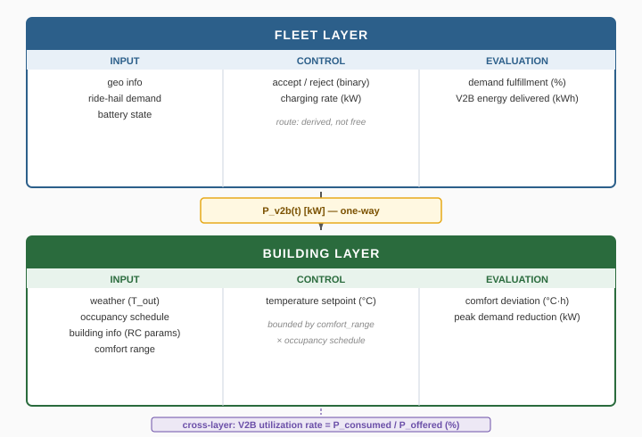

# v2b-cosim

A co-simulation framework for Vehicle-to-Building (V2B) energy management research.

The framework separates concerns into two independently replaceable layers connected by a one-way physical interface. Swap out any controller without touching the other layer or the evaluation code.



## Architecture

Each layer follows an **Input / Control / Evaluation** structure.

| | Fleet Layer | Building Layer |
|---|---|---|
| **Input** | geo info, ride-hail demand, battery state | weather, occupancy, building info, comfort range |
| **Control** | accept/reject (binary), charging rate (kW) | temperature setpoint (°C) |
| **Evaluation** | demand fulfillment (%), V2B energy (kWh) | comfort deviation (°C·h), peak reduction (kW) |
| **Interface out** | `P_v2b(t)` → | ← consumed by building optimizer |

**Interface:** `P_v2b(t)` is a `pd.DataFrame` (DatetimeIndex × building_id → kW available). The fleet declares availability; the building decides how much to consume. All values are in physical units — no pricing assumed.

**Cross-layer metric:** V2B utilization rate = P\_consumed / P\_offered (%). This is the primary metric for evaluating the two layers together.

## Repo layout

```
simulator/
  fleet/base.py          abstract ICE interface
  fleet/heuristic.py     example: SoC-threshold rule
  building/base.py       abstract ICE interface
  building/lp.py         example: day-ahead LP (Pyomo + Gurobi)
interface/v2b_signal.py  P_v2b schema + validator
runner/cosim.py          harness: fleet → validate → building
evaluation/metrics.py    all metrics, physical units only
data/loaders/
  fleet.py               Chicago taxi loader
  building.py            BDG2 loader
examples/run_demo.py     end-to-end demo (synthetic data)
docs/architecture.svg    system diagram
```

## Quick start

```bash
pip install pyomo pandas numpy
# add Gurobi if using building/lp.py
python examples/run_demo.py
```

## Plug in your own controller

Subclass `FleetSimulator` or `BuildingOptimizer`, implement `load_inputs()` and `run()`. The runner and all evaluation code stay unchanged.

```python
from simulator.fleet.base import FleetSimulator

class MyFleet(FleetSimulator):
    def load_inputs(self, geo_info, ride_demand, battery_config):
        ...
    def run(self) -> pd.DataFrame:   # returns P_v2b
        ...
```

## Temporal contract

Both layers must share the same `DatetimeIndex` frequency (default: `"15min"`). The fleet layer is responsible for aggregating any event-driven internal state to this frequency before returning `P_v2b`. See `interface/v2b_signal.py → validate()`.
